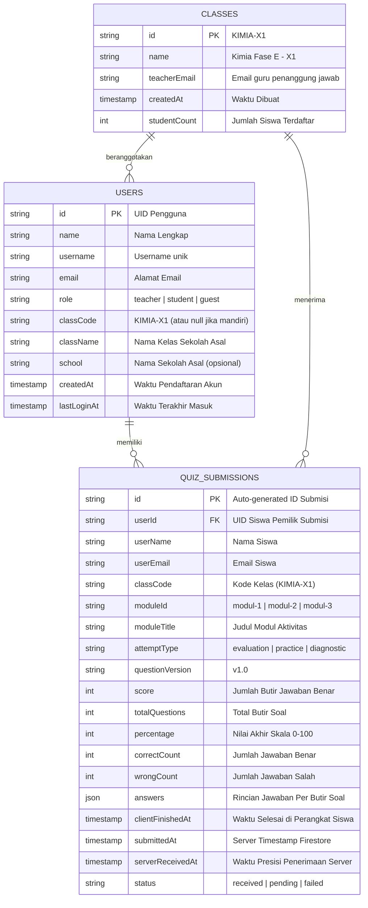

# DOKUMENTASI STRUKTUR BASIS DATA & KONTRAK DATA HASIL BELAJAR
**ElectroFun Chemistry — Pembelajaran Larutan Elektrolit & Nonelektrolit SMA**

---

## 1. Arsitektur Cloud Firestore

ElectroFun Chemistry menggunakan Cloud Firestore dengan skema dokumen modular untuk menghubungkan akun pengguna, keanggotaan kelas, dan riwayat hasil pengerjaan kuis siswa secara aman dan terstruktur.



---

## 2. Struktur Rincian Jawaban Per Butir (`answers`)

Setiap dokumen submisi pada koleksi `quiz_submissions` menyimpan snapshot lengkap dari butir pertanyaan yang dikerjakan siswa untuk menjaga validitas historis:

```json
{
  "answers": {
    "m1-q1": {
      "questionId": "m1-q1",
      "questionText": "Seorang siswa menyatakan bahwa kristal NaCl dapat menghantarkan listrik...",
      "selectedOptionId": "B",
      "selectedOptionText": "Kurang tepat, karena ion dalam kristal NaCl tidak bebas bergerak...",
      "optionsSnapshot": [
        { "id": "A", "teks": "Benar, karena semua zat yang mengandung ion..." },
        { "id": "B", "teks": "Kurang tepat, karena ion dalam kristal NaCl tidak bebas bergerak..." },
        { "id": "C", "teks": "Benar, asalkan kristal NaCl berukuran cukup besar..." },
        { "id": "D", "teks": "Salah, kristal NaCl sama sekali tidak tersusun atas ion..." },
        { "id": "E", "teks": "Benar, karena ikatan kovalen di dalamnya mudah terputus..." }
      ],
      "correctAnswerId": "B",
      "isCorrect": true,
      "pembahasan": "Pada kristal NaCl padat, ion Na+ dan Cl- terikat kuat dalam kisi kristal sehingga tidak dapat bergerak bebas menghantarkan muatan listrik...",
      "caraPengerjaan": "Identifikasi wujud zat dan mobilitas pembawa muatan...",
      "rumus": "NaCl(s) -> kisi ion kaku (tidak bebas); NaCl(aq) -> Na+(aq) + Cl-(aq) (bebas bergerak)",
      "questionVersion": "v1.0"
    }
  }
}
```

---

## 3. Aturan Percobaan Siswa (Trial Rules)

Pada Panel Guru, siswa yang mengulang kuis beberapa kali dihitung dengan aturan deduplikasi:

1. **Percobaan Terakhir (`latest`) — Default Rekomendasi Pedagogis:**
   - Menghitung nilai dari pengerjaan terbaru siswa berdasarkan `serverReceivedAt`.
   - Mengapresiasi peningkatan pemahaman setelah siswa membaca pembahasan.
2. **Nilai Tertinggi (`highest`):**
   - Mengambil submisi dengan persentase tertinggi untuk setiap kombinasi `(userId, moduleId)`.
3. **Percobaan Pertama (`first`):**
   - Mengambil submisi awal siswa murni sebagai evaluasi diagnostik awal sebelum melihat kunci jawaban.

*Catatan:* Seluruh riwayat percobaan tetap tersimpan di database dan dapat dilihat pada rincian profil siswa.

---

## 4. Status Penerimaan Server

- `received`: Berhasil diterima dan divalidasi oleh server. Masuk ke perhitungan nilai dan analisis butir soal.
- `pending`: Sedang dalam antrean transmisi lokal. Tidak dihitung sebagai nilai nol.
- `failed`: Gagal terkirim karena putus jaringan. Tersimpan di cadangan lokal perangkat siswa.
